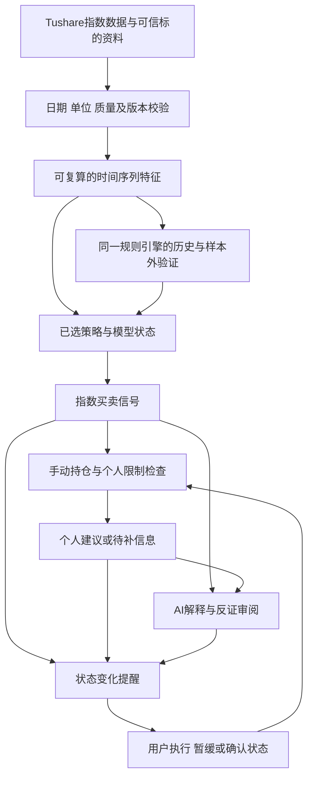

**ClawIndex VNext：行业指数择时与投资决策系统设计**

设计日期：2026-10-12。实施状态：VNext 1.0首版已实现，并在独立数据库完成迁移、离线验证与测试；未切换生产或开启实时通知。运行口径与首版边界见 [VNext运行手册](D:/Develop/ClawIndex/docs/VNext-Runbook.md)。以下保留原设计，候选策略、自动环境路由、真实基金绩效等扩展不应误读为首版全部实现。

**1. 已确认的需求与需要纠正的前提**

用户已明确：以行业基金择时为主，保留清晰的买入、卖出提醒；现阶段市场数据主要来自Tushare指数接口，账号为6000积分档；账户信息需要用户手动填写和维护。新版按这一目标设计，长期资产配置可作为扩展，不占据首页或替代择时功能。

系统可以判断某条规则是否满足，不能保证市场随后按预期变化。第一性原理能约束系统职责、资金语义与错误处理，不能证明MA120优于MA60，也不能直接推出一个有超额收益的阈值。信号规则必须作为可检验的研究假设管理。

“市场风格会变化”也不自动证明“切换策略更好”。策略切换需要实时可观察的条件、明确的进入和退出规则，以及包括误判和交易成本的整套验证。

只有指数信息时，输出指数买卖信号及适用条件；用户补充持仓后，输出其个人操作建议；提供资金与实际产品信息后，才计算具体调整金额。三种能力独立降级，账户资料缺失不阻止指数巡检。

待用户在配置阶段填写的事项：实际基金与监控指数的对应关系、持仓状态、分配给该策略的预算、策略目标、风险约束、可接受的交易频率。这些缺失不阻止本设计完成；缺失值不会被程序默认为零或由AI补齐。

**2. 旧版迁移的工程约束**

生产快照仅在本地只读审阅，原始审阅报告、账号、持仓和推送配置不随源码发布。设计保留下列通用结论：

| 约束 | 设计含义 |
| --- | --- |
| 多用户共享行情，持仓及提醒独立 | 数据复用与个人权限分别设计 |
| 行情日期可能落后于文件日期 | 根据交易日历和发布时间判断新鲜度 |
| 旧百分比是目标投入完成度 | 不把它换算为组合权重、杠杆或总持仓 |
| 旧默认因子缺少可追溯来源 | 不当作已验证的历史证据，后台重新取得 |
| 提示词和标的身份可能有错误 | 先核实事实与规则，再迁移配置 |
| 已删除行情不一定能够重建 | 归档原始记录并明确历史证据缺口 |
| 快照开关不代表云端实时状态 | 原设置保留，部署后单独确认运行状态 |

**3. 从基本约束推导系统职责**

| 基本约束 | 推导出的产品和工程要求 |
| --- | --- |
| 指数是市场观测对象，基金是交易产品 | 标的身份、指数信号与实际产品映射分开；信号不能宣称等于基金成交效果 |
| 同一市场状态对空仓和持仓者意义不同 | 市场信号与个人动作分开；未知、空仓、有仓、已过期分别表示 |
| 资金有限，亏损具有路径依赖 | 买入条件与预算、风险限制分开；先检查个人限制再生成操作建议 |
| 数据只在某个时间之后可知 | 保存市场日期、可用时间、获取时间与版本；回测遵守信息可见性 |
| 同一规则应该可复现 | 指标、规则判定与状态转换由程序计算；AI负责解释、审阅和研究草案 |
| 策略可能失效 | 保存研究阶段、样本外表现和适用限制；风险响应不以低估或希望回本为理由失效 |
| 提醒本身不改变持仓 | 记录待执行事项与用户反馈；模型状态和真实持仓保持独立 |
| 服务和模型可能失败 | 保存失败运行，展示最后有效结果的真实日期；失败不生成持有结论 |

工程可靠性与投资有效性分别验收：数据和规则正确是上线条件之一，盈利能力仍需研究；历史验证也不构成未来收益保证。

**4. 产品形态与默认流程**

新版定位为“能够验证、解释和追踪执行的行业指数择时系统”。第一版继续输出建议，由用户完成交易并登记结果。



| 使用层级 | 需要的数据 | 能提供的输出 |
| --- | --- | --- |
| 指数观察 | 指数代码、策略选择 | 明确买入/卖出/持有/观望信号、触发条件、模型历史结果 |
| 持仓辅助 | 额外手填未知/空仓/有仓、更新时间，可填投入完成度和浮盈亏 | 已持仓对应减仓、持有，空仓对应建仓或等待；资金未知时不显示数量 |
| 资金辅助 | 额外手填策略预算、当前投入或市值、可用资金；必要时补实际基金与持仓 | 可核验的调整金额、预算检查；仅完整账户信息支持真实组合权重与总风险 |

用户可以长期停留在指数观察层。系统首页继续以行业择时为中心；账户完善是增强功能，不成为所有分析的前置条件。

**5. 标的资料与数据接口设计**

标的使用内部ID，保存provider、完整代码或国际指数代码、编制机构、资产类型、行业层级、市场、时区、日历、币种（适用时）、数据路由和身份来源。指数后缀不能独自决定交易日历；用户给出的[指数代码标准化说明](https://tushare.pro/document/2?doc_id=93)明确其可标识编制机构或数据来源。[指数基本信息](https://tushare.pro/document/2?doc_id=94)提供名称、发布方、类别等资料。

`850531.SI`登记为申万黄金行业股票指数；真实现货黄金另设独立标的。`801010.SI`登记为农林牧渔一级行业。旧分类wide_base不会将种子、生猪养殖或锂电池改成宽基。IXIC与纳斯达克100分别登记；同名、相似代码和相近走势不能替代实际产品映射。

标的事实全局唯一；用户采用的策略通过独立assignment关联，不再由全局category决定。两名用户可对同一指数采用不同规则、参数或研究版本，共享行情但不共享个人决策。

| 数据 | 第一版路由 | 缺失时的处理 |
| --- | --- | --- |
| 申万行业身份 | index_classify、index_basic及已核验清单 | 身份未核验则显示待确认；不让提示词补写 |
| 申万行情及PE/PB | sw_daily | 核心行情缺失则暂停新信号；估值缺失只影响依赖估值的规则 |
| 其他支持的国内指数行情 | index_daily | 接口覆盖与身份对应后才启用；不能把申万送入此接口 |
| 国内部分指数估值 | index_dailybasic或经核验的专用数据源 | 逐指数建立能力表；不能假定所有行业或宽基都有估值 |
| 恒生科技及其他支持的国际指数 | index_global | 建立各自市场日历与发布时点；成交额缺失保留缺失语义 |
| 技术因子 | 优先本地复算关键特征；idx_factor_pro作为扩展或核对 | 可选因子失败不影响不依赖它的策略；必要因子缺失则阻止相应规则 |
| 国债利率 | Akshare历史序列及来源记录 | 无可靠值则相关代理指标不可用；不写固定值冒充观测 |
| 实际基金映射 | 用户填写并附官方依据；未来接可用产品接口 | 未确认时仅作行业参考，不输出该基金的具体数量 |

官方文档规定[index_daily](https://tushare.pro/document/2?doc_id=95)不包含申万行情。sw_daily成交额单位是万元，index_daily与专业因子文档中为千元。内部金额统一为元，保留原字段单位；成交量保留来源单位，跨来源比较前验证，不能直接拼接。[申万行情文档](https://tushare.pro/document/2?doc_id=327)、[专业因子文档](https://tushare.pro/document/2?doc_id=358)

6000积分档按现有官方文档覆盖上述主要指数分析门槛，但仍需在实施时用账号做受控能力检查。专业因子当前5000积分档频率为每分钟30次；适配器按接口限流，保留有界重试及节流，不能只按总积分推断频率。

[ETF基础信息](https://tushare.pro/document/2?doc_id=385)与[ETF基准指数列表](https://tushare.pro/document/2?doc_id=386)当前门槛为8000积分。它们是后续可选能力，不作为第一版依赖，也不要求用户现在升级会员。

数据客户端返回统一状态：OK、CLOSED、NOT_YET_PUBLISHED、DELAYED、NO_PERMISSION、FAILED、UNSUPPORTED。空响应本身不能证明休市；判定依据为对应市场日历、当前时刻和接口发布约定。日历无法确认时显示不确定并阻止假装当天已有新数据。

**6. 数据质量与时间序列特征**

每条观测记录session_date、source、source_method、original_unit、fetched_at、available_at或其可用时间假设、revision、quality_flags。国内、港股、美股各按自己的已完成交易时段判断新鲜度；跨市场不强求相同日期，同一指数的价格与技术条件必须在同一截止时点可用。

必要数据的断档不能用前值填充后继续计算连续确认。正常休市不算断档；缺少一个应有交易日会使相关连续条件失效，补齐后重新计算。异常涨跌先进行来源和OHLC一致性检查，不因跌幅很大就删除真实行情。

数据质量按字段与策略依赖计算。MA60数据充足但MA120不足时，前者仍可展示；依赖MA120的策略状态是数据不足。NaN、Inf、负值不合法口径、重复日期、单位冲突都有独立原因码。

第一版特征清单：

| 特征 | 明确定义 | 用途 |
| --- | --- | --- |
| MA20/60/120/250 | 当前与过去N-1个有效交易时段收盘价的算术均值；不足N不产生值 | 趋势及结构 |
| 均线5时段变化 | MA_N(t)/MA_N(t-5)-1；每个值只用当时可见数据 | 方向，禁止由均线排列代替 |
| 连续站上/跌破日数 | 每个应有交易日close严格大于/小于对应当天均线；相等中断计数 | 时间确认 |
| 穿越事件 | 前时段位于线的一侧或相等，本时段进入另一侧；严格定义方向 | 区分今天触发与条件持续 |
| 5/20/60时段收益 | close(t)/close(t-N)-1 | 动量及变化描述 |
| 成交额比 | 当前成交额/近20时段均额，含当前日，分母必须有效且大于0 | 量能；无数据不以涨跌幅替代 |
| 波动与回撤 | 明确收益口径、窗口、年化参数、最高点窗口；均为指数指标 | 情景、持仓风险提示 |
| PE/PB历史分位 | 仅有效口径观测，窗口截止t，保存样本数与窗口起点 | 历史位置；不直接等同内在价值 |
| 扩展技术特征 | ATR、MACD、OBV、MFI等带参数和算法版本；方向另行计算 | 经声明的策略依赖 |

背离暂不纳入第一版主策略。它需要明确峰谷窗口、方向、确认时间和数据依赖，不能让模型看单日数值猜测。需要时通过特征注册表扩展。

`PB/PE`显示为隐含盈利能力代理，`1/PE-rf`显示为盈利收益率与国债收益率利差代理。输入口径、来源、单位或币种不匹配时不可用。旧库1.72%记录保留为来源未知历史值，进入新版依赖计算前须重取或标记不可用；不能逐条断言全部为兜底，也不能继续当可信历史序列。

指标勾选改成展示与研究偏好。主策略必需的特征由声明自动加载，用户不能通过取消勾选让规则在缺少必要输入时运行。

**7. 策略体系：先建立可证伪基线**

第一版采用策略注册表与受限规则表达式：支持已注册特征、明确比较条件、AND/OR、时段确认与优先级；禁止执行提示词中的任意代码。配置发布前检查字段依赖、单位、完整边界、可达性和冲突。相同数据快照、配置版本及先前模型状态，产生相同结果。

建议首个研究基线`trend_confirm_v1`，参数N=120、确认3个交易时段、均线变化窗口5个时段。这些是起始实验设置，不是盈利承诺或第一性原理结论。

模型仅有FLAT和LONG两个有效持有状态，表示研究组合是否持有一单位指数敞口，独立于用户真实持仓。首次运行从固定历史起点、充分预热后的FLAT状态逐日回放，以恢复状态；记录预热和起点。切换起点需产生新研究版本。

| 顺序 | 条件 | 状态与信号 |
| --- | --- | --- |
| 0 | 必要数据无效或不新鲜 | 本次不产生有效新信号；保留旧状态及旧结果日期 |
| 1 | 连续3个完整交易时段close<MA120 | exit_condition_active=true；LONG→FLAT产生卖出事件，FLAT保持观望 |
| 2 | 连续3个完整交易时段close>MA120且MA120五时段变化>0 | entry_condition_active=true；FLAT→LONG产生买入事件，LONG保持持有 |
| 3 | 上述条件均未满足 | 保持模型先前状态；LONG为持有，FLAT为观望 |

当日价格等于均线不计入站上或跌破。确认期内不提前跳转；exit优先。基线没有自动分批加仓，反复出现同一条件不会每天新建一笔交易。

每次结果同时记录signal_event（BUY/SELL/NONE）、signal_state（HOLD/WAIT）、entry/exit当前条件、首次触发日、最近确认日和research_stage。新订阅时可以展示持续有效条件，但不能把过去触发日期写成今天；首次推送是当前状态摘要。

估值在基线中用于描述与研究对照，不否决已定义的退出。由此消除电池“低估禁止卖”的冲突。未来的估值增强策略需要完整档位映射、相同退出纪律和独立版本；不得把PE/PB条件以自然语言临时补进生产动作。

主策略是趋势基线的设计建议。实施后必须先研究，再选择是否启用提醒；若结果不符合预定目标，可以保留为观察策略，不能把回测不好解释成“模型需要更自信”。发布时必须先写清目标是降低回撤、减少换手、提高收益还是其他可衡量指标，以及愿意为此付出的机会成本；没有确定目标就不宣称某个策略更优。

其他候选：估值约束的趋势策略、震荡均值回归策略、组合相对强弱排序。全部使用同一特征与回放引擎，逐项研究；第一版不一次引入大量自由参数。

市场环境显示为趋势向上、趋势向下、震荡或不确定，并注明计算窗口及依据。它描述当前观测，不给“已确定牛市”标签。未来环境路由策略必须把识别错误、切换迟滞与成本纳入样本外验证；不得事后选择每段最优方法。

**8. 手动持仓、个人建议与风险规则**

持仓表区分UNKNOWN、EMPTY、HELD、STALE，字段都带as_of和reported_at。投入完成度、实际组合权重、基金份额、基金市值、浮盈亏各有独立字段与口径。明确填写EMPTY才表示空仓。旧0值只能证明当时系统给出了零，若无法确认是否用户主动填零，迁移为旧记录语义待确认。

用户可以只填写有仓/空仓与日期，其他信息可选。保存投入完成度不要求同时提供浮盈亏；两个字段各自显示未知。持仓报告的过期阈值可配置，初始界面建议7个自然日复核，但它只是维护设置，不保证期间没有交易。可一键确认“期间未交易”；价格变化不会被当作份额变化，手工市值不会假装自动更新。

| 指数条件 | 手动状态 | 个人输出 |
| --- | --- | --- |
| 当前买入条件满足 | UNKNOWN/STALE | 买入信号；持仓待确认；无金额和仓位指令 |
| 当前买入条件满足 | EMPTY | 可考虑建仓；预算缺失只给定性建议，预算约束通过后才给额度 |
| 模型LONG且未退出 | HELD | 持有；是否追加由独立已发布规则决定，基线不自动追加 |
| 当前退出条件满足 | HELD | 卖出/减仓建议，动作按选定执行规则；资金信息不足不伪造比例 |
| 当前退出条件满足 | EMPTY | 保持空仓，避免无资产可卖的指令 |
| 当前退出条件满足 | UNKNOWN/STALE | 卖出信号，对已持仓者适用；请求确认持仓，不能称其已减仓 |
| 条件不明确且模型FLAT | 任意 | 观望；若用户仍持仓而模型FLAT，保留持仓偏离提醒 |

允许用户在错过原始买入事件后，根据仍然满足的当前条件创建建仓建议；明确标为“持续条件下建仓”，不伪装为新突破。这一个人规则必须在配置中启用并参与验证。默认不自动补买或追补已错过的收益。

个人约束优先级：数据和身份有效性→持仓及资金可确认性→用户明确的预算/流动性/敞口限制→风险退出→策略买入→持有或观望。市场BUY信号可以与个人WAIT建议同时存在，原因必须显示，例如预算已经用完。

金额计算只在市值、可用资金、币种和目标口径齐全时启用。完整账户的权重为该项实际市值/同期账户净资产；没有分母就显示未知。行业持仓不能仅凭监控清单反推出账户集中度。没有确认真实基金映射时，指数回撤不能被标成该基金或账户亏损。

预算上限与持仓限制是建议生成约束；实际市场变化、人工不执行、跳空和交易延迟都可能让实际风险超过预期。最大回撤阈值是复核或退出触发器，不是保证最大亏损的机制。

**9. AI的职责与提示词升级**

线上事实、数值、状态和动作由程序确定。AI提供简洁解释、反证审阅、情景讨论和待验证的策略草案；它可以指出规则的潜在缺点，但不会在同一次解释中改写已发布规则的动作。

新的提示词由三层组成：系统事实与输出约束、程序生成的证据及规则结果、用户的解释偏好。用户仍可定制分析重点和语言风格，策略修改进入独立配置草案及版本流程。旧长提示词原文归档，以待整理的研究材料展示，不原样作为线上强制执行器。

示例解释契约：

```json
{
  "summary": "简洁解释当前规则结论",
  "evidence_refs": ["close", "below_ma120_sessions"],
  "limitations": ["真实基金及持仓未确认"],
  "counterarguments": ["退出后可能出现快速反弹"],
  "scenarios": [
    {"assumption": "未来出现反弹", "implication": "本策略可能较晚重新进入"}
  ]
}
```

契约采用严格结构校验，未知字段、缺必要字段、无效引用或截断响应均记为解释失败。关键数值、动作和日期由程序直接渲染，减少模型数字错误。结构校验不能保证所有自然语言语义真实，核心交易依据只采用规则证据；额外断言标为假设或审核失败。

解释失败时用程序模板展示已验证规则，照常保存有效指数信号；保留LLM失败运行并按健康通道通知。与旧版相比，AI可用性不再决定市场信号是否存在。不得将格式失败转成持有，不使用模型自评confidence代表胜率。

界面显示“数据状态、已满足条件/必要条件、研究阶段”，例如“退出条件满足3个连续交易时段；策略仍在研究中”。这些信息可核验，但仍不能被称为上涨或盈利概率。

模型请求只发送本次需要的字段。提示词、返回内容与完整证据快照保存在用户隔离的审计存储；普通日志不记录Webhook密钥、API密钥或完整财务上下文。模型版本、解释提示词版本和输入哈希构成解释缓存键，个人缓存加入用户与持仓版本，避免跨用户泄漏。

**10. 输出契约、提醒与执行反馈**

一次巡检返回三个独立结果：

```text
SignalResult
  instrument_id / strategy_version / dataset_version / feature_version
  market_as_of / evaluated_at / previous_model_state / model_state
  entry_condition_active / exit_condition_active
  event_type / state_label / triggered_at / rule_trace
  data_status / reason_codes / research_stage

PersonalDecision
  user_id / position_report_id / execution_policy_version
  status: AVAILABLE | CONTEXT_REQUIRED | BLOCKED
  action: BUY | SELL | REDUCE | HOLD | WAIT | null
  amount / currency / exposure_basis（必要字段缺失时为null）
  reasons / required_context / expires_at

ExplanationResult
  status: MODEL_OK | TEMPLATE | FAILED
  model_id / prompt_version / input_hash / evidence_refs / content
```

“数据不足/分析失败”属于状态，不是HOLD或WAIT。必要数据无效时本次signal_state为空、event_type为NONE，旧model_state仅以最后有效日期作历史引用；首次尚未预热时模型状态也为空。全部运行都有run_id；成功和失败追加保存。最后有效结果只是一个查询投影，不能覆盖历史来假装当天成功。

推送分三类：新买卖信号或当前条件修订；个人待执行或风险升级；系统数据/模型/投递异常。周度复盘单独配置，默认相同状态不日复一日重复推送。用户可设待执行提醒节奏；暂缓可到期复核，不能无限隐藏持续存在的风险。

投递使用持久化outbox和有界重试。去重键包含接收用户、渠道、策略实例、信号episode或个人decision事件；去重不能只靠共享Webhook URL压掉另一名用户不同结论。成功同时校验HTTP状态与飞书业务返回码。已启用渠道只接收所属用户事件，公共共享目的地另需明确配置范围。

执行状态为PENDING、ACKNOWLEDGED、EXECUTED、PARTIAL、DEFERRED、EXPIRED、CANCELLED。点击“已读”不会修改持仓；登记已执行后由用户确认持仓变化或录入交易。未提供真实成交价、数量和成本时只保存执行反馈，不能计算真实交易收益。

示例卡片（假设数据，非当前电池建议）：

```text
电池｜卖出条件生效
数据截至：示例交易日收盘
规则：连续3个完整交易日收于MA120下方
策略：trend_confirm_v1（研究中）
你的持仓：未确认
适用说明：已持仓且采用该策略者复核退出；空仓者继续等待
执行金额：缺少预算和实际产品信息
可能代价：退出后反弹，重新进入价格更高
操作：确认持仓 / 登记执行 / 暂缓并说明理由
```

**11. 界面与维护成本**

采用现有Streamlit技术，按页面和服务拆分。首页提供买入信号、卖出信号、持有、观望和异常筛选；默认突出新事件、持续退出但仍有仓、待确认持仓，以及数据延迟。

每张卡片首先显示信号、市场截止日、策略版本和持仓状态；其次显示程序证据和个人动作；AI解释位于其后。历史触发与今天持续满足分开显示。

其余页面：指数资料与数据质量；策略配置与研究对比；手动持仓及预算；历史分析与执行反馈；系统健康及推送设置。用户修改阈值可先预览历史信号变化和新增数据依赖，发布后生成新版本。

旧“提示词配置”升级为“策略与分析偏好”：交易条件采用结构化配置，文字偏好保留。预算字段在未填写时直接说明能力边界，正常浏览无需反复弹窗阻断。

产品上避免展示实现细节。技术哈希、API响应和调度日志放入诊断页；信号页展示用户真正需要判断的数据、条件与限制。

**12. 技术架构与数据模型**

继续使用Python、Pandas、SQLite、Streamlit和现有模型客户端，采用模块化单体。当前4用户规模无需先引入微服务、消息中间件或重写全部前端。具体依赖版本在实施时锁定并验证。

建议目录职责：

```text
clawindex_next/
  domain/          标的、状态、持仓、规则与输出类型
  adapters/        Tushare、Akshare、模型、飞书、市场日历
  features/        纯计算函数、依赖注册表、质量检查
  strategies/      策略注册、版本校验、确定性状态机
  services/        巡检、个人判断、执行反馈、研究编排
  repositories/   SQLite读写与短事务
  ui/             Streamlit页面
  research/       回放、成本情景、样本外与结果导出
  migrations/     离线迁移与验证
```

界面通过服务层提交巡检任务，独立worker执行；任务、租约、重试与outbox落库，UI重跑不重复触发同一任务。SQLite保持WAL与忙等待，网络调用在数据库事务外执行；worker使用数据库租约和唯一约束防止多进程重复调度。不会只依靠Python线程锁或Streamlit会话状态保证唯一运行。

有效信号、个人判断和待投递事件先在短事务中落库，再进行模型解释；模型响应不能阻塞或撤销已确认的市场事件。旧日期重放只追加历史结果，不把较早状态覆盖到当前状态投影；当前模型状态按交易时段顺序推进，数据修订需要指定版本重放并产生修订记录。

| 新实体/表组 | 关键语义 |
| --- | --- |
| users、user_id映射 | 保留旧username关联，按账号名选择用户空间，服务端按会话账号与既有角色筛选数据 |
| instruments、aliases、watchlists | 可信标的、源代码别名、用户监控；策略不作为身份属性 |
| market_observations、dataset_snapshots | 来源、日期、单位、revision；快照清单与哈希能重放输入 |
| feature_snapshots | 算法版本、依赖、窗口、质量和不可变指标JSON |
| strategy_versions、strategy_assignments | 不可变参数与规则；用户生效历史、模型初始化起点 |
| manual_position_reports、budget_profiles | 追加手动记录、字段口径、更新时间；最新值通过查询得到 |
| signal_runs、personal_decisions | 模型状态与个人动作分开保存；允许有信号但个人上下文缺失 |
| explanation_runs | 模型版本、输入引用、结果和失败，独立于信号成功与否 |
| execution_feedback | 实际反馈、暂缓理由；有充分字段时才记录真实交易 |
| notification_outbox、delivery_attempts | 事务化事件、接收范围、幂等键及投递结果 |
| job_runs、worker_leases、health_events | 单次运行、失败、重试、租约及异常恢复 |
| research_runs、research_results | 样本切分、规则版本、指标口径、成本假设和样本外结果 |
| legacy_archive、migration_runs | 原始历史、完整迁移计数与版本记录 |

持仓、策略、分析和历史执行均按用户隔离；行情与纯市场特征可共享。市场信号只有在完整策略、数据版本、初始状态和回放起点一致时才能复用，个人决策不据两个相同百分比跨用户复用。

金额采用明确货币精度，必要时整数最小货币单位；份额及精确预算计算使用十进制口径。技术特征可以浮点计算，但有有限值检查、算法版本和确定的比较规则。

2026-10-12需求调整：仅本人及朋友使用，取消密码，按账号名进入，首次输入新名字自动创建普通账号。账号名不能证明真实身份，但按用户明确要求采用这种使用方式。服务端仍按会话中账号隔离监控、持仓与历史；调度总开关等操作沿用管理员角色，本机CLI可配置角色。已有数据库保留废弃的password_hash列以兼容，不校验或依赖它，不要求重新迁移。

移除监控关系仅停止后续任务，不删除持仓、执行或已有分析依赖的数据。归档和保留策略独立管理；已被历史快照引用的数据不通过界面删除监控自动清理。

**13. 研究和样本外验证**

真实巡检与回测复用同一纯特征和规则函数，逐日推进市场时段与模型状态。禁止回测版提前看到未来分位、未来完整均线或后续修订值。

现有数据首先支持指数策略研究。无实际基金、交易费用、产品限制、净值时点或汇率处理时，不能把指数回测写成个人账户收益。成本采用明确情景参数，输出价格指数收益、成本情景收益与真实产品收益（后者未知时不显示）。零敞口部分的收益假设单独声明；未知历史利率时不借旧1.72%构造现金收益优势。

盘后信号不能按已经结束的当日收盘价成交。指数研究的基础执行假设为下一有效交易时段开盘，缺失则等待，不用有利价格填补；同时测试合理执行延迟和成本变化。真实基金版本需另行适配场内成交或场外净值规则。基金净值需区分净值日和公告日，[Tushare净值文档](https://tushare.pro/document/2?doc_id=119)提供这两个字段；不因nav_date较早而假定当时已经可知。

比较基准包括：同一指数持续持有、固定趋势基线，以及在有投入计划时的固定定投。每一策略都报告净收益、最大回撤、波动、换手、费用敏感性、空仓时长、最长落后区间、买卖次数及市场阶段差异。胜率和“信号出现后上涨”不能单独作为上线标准。

按时间顺序保留未参与调参的样本外区间，并做滚动训练/验证。一个可用的起始切分是前60%开发、中间20%验证、最后20%保留测试，比例需结合各指数样本长度确定；查看测试结果后调参，就必须标明已使用测试样本或保留新的未来观察区间。

检验附近参数是否表现稳定，记录尝试过的参数数量；跨行业结果不合并掩盖单行业失败。SW2021回溯口径、成分调整和发布前回溯数据单独标注，不将全部回填历史视为当时可投资的产品记录。

研究阶段为DRAFT、RESEARCH、SHADOW、ENABLED、RETIRED。每个阶段记录证据与限制。未验证策略可以显示有明确标签的观察性买卖信号，但不能宣称已经有统计优势。工程上线和用户选择启用某策略是两个不同事件。

上线后的监控包括数据完整性、信号与回放一致性、换手异常、执行反馈、实际与假设成本差，以及阶段性落后。若数据错误或代码错误，暂停相应信号；若投资表现不佳，按预设复核条件审阅，不让模型每日自主换策略。

**14. 生产迁移与回滚方案**

采用独立VNext数据库及离线迁移命令；旧应用继续使用原库，VNext启动不自动ALTER旧库。既保留生产历史，又避免新旧应用同时对不兼容结构写入。

1. 从明确的源路径获得一致性备份。若源是正在写入的WAL数据库，使用SQLite Online Backup API；不能只复制主db文件忽略WAL。[SQLite官方备份说明](https://sqlite.org/backup.html)
2. 在新路径创建带schema版本的新库，逐表归档原始数据，再转换可确认的字段。源路径与目标路径必须不同，命令先做dry-run并输出计数及冲突。
3. 历史275条报告保留原文、原action、旧confidence、已存指标和持仓快照，标legacy。缺少旧提示词版本、输入日期、已被同日覆盖或已清理行情的内容不能重建；标不可完整重放，不伪造证据。
4. 10条旧持仓保留为目标投入完成度和手报浮盈亏，不能导入真实组合权重。当前持仓作为待复核旧报告；NULL历史保持未知，旧自动零无法证明主动空仓。
5. 11份旧提示词归档并生成问题清单；黄金错误前提不得转成可信资料，含冲突的规则不自动发布。旧category保存legacy标签，用户策略重新关联。
6. 保存4个用户、11条监控、1个Webhook记录与3个设置的归档及映射。Webhooks及密钥仅在受保护的迁移目标保存，不写审阅日志；导入不发送试消息。现有关闭开关原样保持。
7. 验证源/归档各表计数、规范化逐行摘要、关键引用、日期、用户边界及SQLite完整性。标的转换失败的记录进入隔离列表，历史不丢弃。
8. 用副本回放和影子任务验证，只有新环境指定开启后才发送通知。切换前做最终一致性备份并短暂停止旧写入；第一版选短暂停机迁移，避免引入未验证双写同步。
9. 旧库与旧发布保持可启动。若回滚，先停止VNext worker和outbox；导出VNext期间新增的持仓与执行反馈，确保用户不会误以为旧界面含这些新增记录，再恢复旧发布。回滚不删除VNext证据。

应用通过显式数据库路径及预期schema版本打开。路径错误、库缺失或版本不符时启动失败并说明原因，不能静默创建空库。迁移时间、源哈希、目标版本和验证结果进入migration_runs。

这是对旧规范的有意兼容性调整：未知不再当空仓、JSON失败不再当持有、模型失败不再阻断已验证信号、事实类型与用户策略解耦。现有旧版接口保持原状；实施VNext时为新模块同步更新规则说明和测试，不将旧版局部约定当成必须延续的投资事实。

**15. 实施阶段及验收条件**

| 阶段 | 交付 | 验收后能做什么 |
| --- | --- | --- |
| P0 数据与历史保护 | 独立配置、离线迁移、可信标的与用户身份、单位/日期/缺失校验、旧持仓语义修正 | 可靠地显示已有数据和历史；原库可回滚 |
| P1 择时内核 | 关键特征、确定性状态机、规则版本、基线回放、研究标签 | 输出可复算的明确指数买卖信号 |
| P2 手动上下文与反馈 | 分层持仓输入、个人判断、预算检查、待执行与暂缓记录 | 让同一信号对应不同用户的实际处境 |
| P3 可靠运行与解释 | 独立worker、幂等任务、outbox、模板与AI解释、健康页、身份权限 | 按设置持续巡检与推送，失败可见且不会篡改动作 |
| P4 策略研究与扩展 | 样本外、成本及参数敏感性、候选策略比较、可选环境路由 | 有依据地选择或淘汰策略，逐步扩展数据能力 |

P1需要基础研究与回放一致性测试；P4深化策略比较，不意味着上线前完全没有验证。第一版必需的回归样例：

| 测试情景 | 预期结果 |
| --- | --- |
| 未填写持仓 | UNKNOWN；仍有指数信号，没有个人金额指令 |
| 旧目标完成度60% | 不显示账户权重60%，不计算全账户集中度 |
| 黄金行业配现货文字 | 可信身份不被覆盖，错误配置不能发布 |
| 电池低分位且明确退出成立 | 基线退出生效，估值不能临时否决 |
| 连续2日低于均线、第三日收回 | 不触发3日退出；后续计数重新开始 |
| 其中一个应有交易日缺数据 | 不按相邻可见记录拼成连续3日 |
| MA60足够、MA120不足 | 展示MA60，MA120策略数据不足 |
| 因子比行情晚一日 | 不能混入该行情截止时点的特征 |
| 国际市场尚未收盘或休市 | 不用本地日期生成虚假的今日收盘信号 |
| 同一天重跑、UI重跑、worker重启 | 相同逻辑任务和通知不重复；新版本重跑另有记录 |
| 模型失败、缺字段或声称不同动作 | 采用程序模板；信号不改变，LLM失败记录保留 |
| 同一指数不同用户策略或持仓不同 | 个人结果隔离；符合完整键条件才共享市场结果 |
| 同一Webhook接收不同用户事件 | 不以URL先到先得丢另一用户事件；接收范围明确 |
| 飞书HTTP 200但业务码失败 | 记录失败并有界重试，不能标投递成功 |
| 新行情、资料或规则修订 | 产生新版本与修订记录，旧证据不覆写 |
| 盘后信号回测成交 | 最早使用之后可执行的时段，不偷用当日收盘 |
| 迁移及回滚演练 | 源库摘要不变，历史275条全保留，新增反馈有导出路径 |

上线前必须做到：有效信号的输入与规则版本可追溯；故障不会生成投资结论；必要数据缺失不会伪装完整；手动状态不会被解释成账户事实；依赖用户资料的金额计算只在资料齐全时发生。

此设计先建立可以信任其“做了什么”的系统，再检验其投资方法是否值得采用。用户的行业择时目标与明确买卖提醒保留，未经验证的未来收益不作为产品承诺。
