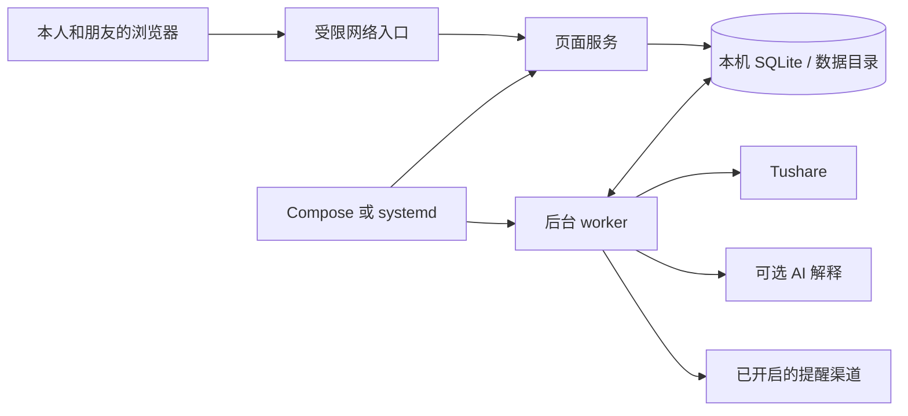

# ClawIndex：跨平台运行与 Linux 部署设计

日期：2026-10-12。状态：**设计方案，尚未实现本文件中的新入口、部署配置或 Linux 验收**。已有Windows测试不能当作Linux部署验证。

2026-10-13实施进展：已在现有本机运行方式中完成默认工作日共享行情更新、持久巡检请求中的行情更新/分析/可选AI阶段、进度弹窗与结果自动刷新、中文证据与解读展示。任务元数据利用现有settings表追加，不需要改动schema。本文以下记录设计时的问题及目标；完整任务类型迁移、研究任务分批、统一生产入口、Compose部署、独立短周期心跳和Linux验收仍待实施。

日常发布与一键更新的配套设计见[一键更新方案](VNext-一键更新方案-2026-10-12.md)：GitHub构建固定版本镜像，服务器统一部署入口，后续接入点击部署。

已确认：系统供本人及朋友使用；只输入账号名；保留明确的指数买卖提醒；未来部署到Linux；用户接受Docker Compose作为生产运行方式。Linux发行版和朋友的访问网络尚未确认。本方案以单机Linux、Docker Compose、受限网络访问为默认；systemd仅作为未来不用Docker时的备选，不列入本轮必须交付。无需为了此设计升级服务器，先在现有机器测量负载。

## 1. 从需要的结果推导运行职责

用户需要的是打开网页、查看可靠的巡检结果和提醒。系统必须在浏览器关闭、SSH断开、服务器重启后继续处理已经保存的任务。页面存在不能证明后台存在，后台存活不能证明行情可用，任务完成也不能证明有可执行的投资信号。

因此定义五个独立职责：

| 职责 | 负责内容 | 不承担的内容 |
| --- | --- | --- |
| 页面 | 账号空间、资料维护、提交请求、进度与结果 | 不依赖页面线程执行生产巡检，不负责重启服务 |
| worker | 同步、校验、计算、解释、投递与研究任务 | 不打开浏览器、不创建默认空库、不自行修改部署配置 |
| 持久数据 | 原始行情、任务、版本证据、反馈、通知队列 | 不放在临时容器或源码发布目录里 |
| 进程管理 | 开机启动、异常重启、终止整组进程、日志 | 不判断买卖、不因投资表现换规则 |
| 管理命令 | 校验配置、迁移、备份、诊断、健康检查 | 不把“进程启动”当作“系统已经就绪” |

bat只是Windows调用入口。现有`start_next.py`已有部分跨平台适配，需要将它的本地便利职责和服务器进程管理职责分开。Linux生产由Compose或systemd负责生命周期；业务代码提供一致的进程入口。

## 2. 现有实现的具体问题

| 代码中的事实 | 影响 | 调整 |
| --- | --- | --- |
| 页面与worker原本需要分别启动 | 用户看到一串Pending而不知道缺什么 | 部署包同时定义两项服务；页面解释后台状态 |
| 本地Python启动器要求保留终端 | 不适合SSH退出、开机恢复 | 生产服务交给进程管理器，本地入口仍可一键启动 |
| worker只对KeyboardInterrupt自然收尾，未明确处理SIGTERM | Linux停止服务时可能留下租约或中断任务 | 显式处理停止信号和有界退出 |
| 心跳租约有效期10分钟 | 服务已退出仍可能看起来近期正常 | 独立心跳、任务进度、排队时长分别判断 |
| 同步、研究、巡检、通知共用一个长循环 | 大批历史同步可能拖延已提交巡检 | 拆为有界子任务、分级优先级、共享接口限流 |
| 用户“提交巡检”只分析本地数据，同步需另点 | 巡检完成却仍是过期数据，操作含义不符合用户直觉 | 默认巡检先确保对应市场的数据，再分析 |
| UI仍可直接调用同步、研究和应急执行 | 绕开worker管理和统一接口额度 | 生产中这些操作统一提交持久任务 |
| 默认数据路径和配置加载散在多个入口 | UI和worker可能读到不同库或配置 | 统一配置解析和启动校验，生产要求显式路径 |
| 仅检查Streamlit HTTP或心跳 | 无法区分数据库故障、后台卡住、接口无权限 | 将服务健康、任务健康、数据质量分开呈现 |

“开启自动同步”是业务设置；“启动后台”是运行条件。**自动同步关闭时，后台仍必须处理用户手动提交的巡检。** 缺少模型密钥只降级为模板解释，不让信号任务卡住。

## 3. 推荐部署结构

同一应用镜像，两个长期进程，一个本机数据目录：



默认一个页面实例、一个worker实例，维持模块化单体。源码/镜像一致，进程角色不同，不引入Redis、Celery、微服务或新的前端框架。现有人数和任务量不足以证明这些新增组件必要。

SQLite继续使用WAL和短事务。两个服务共享**同一Linux主机上的完整数据目录**，包括数据库和WAL/SHM旁文件，不能各用一个容器内数据库，也不能把共享库放到NFS/跨主机目录。依据[SQLite WAL官方约束](https://sqlite.org/wal.html)。如果以后需要跨机器并发或写入负载明显增加，再评估PostgreSQL。

保持只输入账号名，不恢复密码。由于账号名不验证身份，部署默认通过内网/VPN或既有受限入口访问，朋友只需用浏览器；不将“只有朋友会用”当作公网访问限制已经生效。如果需要公开域名，则需另行确定网络访问边界，不能把HTTPS误解为身份校验。

## 4. 一套程序入口，按环境管理

以下为**规划接口**，不是当前可直接执行的完整命令：

| 接口 | 用途 |
| --- | --- |
| `python -m clawindex_next serve --with-worker` | Windows/Linux本地开发，一条命令带页面和worker |
| `python -m clawindex_next web` | 生产页面进程，前台运行，服务管理器托管 |
| `python -m clawindex_next worker` | 已有入口，补充退出信号、独立心跳、任务调度与配置统一 |
| `python -m clawindex_next doctor` | 已有诊断，扩展路径、权限、配置、日历、依赖和数据质量 |
| `python -m clawindex_next health --component web/worker` | 供部署健康检查使用，输出明确状态和退出码 |
| `python -m clawindex_next backup --output PATH` | SQLite一致性备份及校验清单，不复制正在写入的主文件 |
| `python -m clawindex_next upgrade` | 显式升级新版schema，先备份、校验，再执行；不在开机时偷偷改库 |

本地serve负责预检、启动子进程、传入统一配置、打开本地浏览器、处理中断和退出。Linux用进程组管理本地子进程，Windows继续使用平台适配；这部分限定在本地启动器。生产web/worker直接运行，无浏览器、无额外Python双进程总管，不同时叠加Compose与systemd重启同一应用进程。

`start_next.py`和bat可作为兼容包装，调用统一serve入口；文档以统一命令与Linux部署方式为主。

## 5. Linux运行选择

### 默认：Docker Compose

用户已确认采用Docker Compose。服务器需安装受支持的Docker Engine及Compose插件。同一固定版本镜像分别运行web和worker，数据库目录共享，日志进入标准输出，正常操作为：

```bash
docker compose up -d
docker compose ps
docker compose logs -f worker
docker compose stop
```

首次部署另有配置、数据准备和校验步骤，不能声称一条命令就能凭空得到数据库与接口凭据。

计划参数：web监听容器内0.0.0.0，宿主端口默认只绑定127.0.0.1交给受限入口；worker不发布端口；两项服务使用相同UID/GID访问本机持久目录；代码与依赖只读，数据目录可写。镜像不含生产数据库、密钥、个人报告或本机虚拟环境；`.dockerignore`显式排除。

进程退出采用`restart: unless-stopped`；明确设置健康检查、`init: true`与90秒停止宽限。**健康检查变成unhealthy不会仅凭restart策略自动重启**，进程退出才触发对应重启策略；应用应对不可恢复的循环故障退出非零，并对卡死设置有界看门狗。不要把只显示unhealthy当作修复机制。依据[Docker重启策略](https://docs.docker.com/engine/containers/start-containers-automatically/)及[Compose服务配置](https://docs.docker.com/reference/compose-file/services/)。

启动分为“显式部署前校验/迁移”和“日常启动”。UI与worker分别依赖有效数据库和schema，而不强制依赖对方存活：worker故障时页面仍可展示故障和历史，页面重启也不应停掉worker。若使用一次性preflight服务，只进行无副作用校验，使用`service_completed_successfully`作为依赖条件。Compose单纯启动容器不会等待应用就绪，依据[官方启动顺序说明](https://docs.docker.com/compose/how-tos/startup-order/)。

### 可选备选：systemd

使用`clawindex-web.service`和`clawindex-worker.service`，由同一`clawindex.target`统一管理，直接执行固定虚拟环境中的web/worker入口。配置统一通过EnvironmentFile提供，使用专门的普通服务用户；各服务支持开机启动、退出重启、停止超时及整个控制组清理。管理入口为`systemctl`和`journalctl`，没有保留SSH终端的要求。

具体采用`Restart=on-failure`、重启间隔与次数限制、`KillMode=control-group`、明确的`TimeoutStopSec`。失败原因需要能在日志和页面查看，不能无限高速重启。部署时验证发行版的systemd支持。参考[systemd服务官方说明](https://github.com/systemd/systemd/blob/main/man/systemd.service.xml)与[停止进程控制组说明](https://github.com/systemd/systemd/blob/main/man/systemd.kill.xml)。

## 6. 配置、目录与依赖统一

配置优先级为命令行显式值 → 进程环境变量 → 显式指定的配置文件 → 本地开发默认值。生产模式没有静默创建数据库或回落到源码目录的路径逻辑。web、worker和管理命令读取同一个Config对象，并展示非敏感配置版本，便于确认连接到同一套环境。

| 内容 | 容器内建议位置 | 直接Linux部署建议位置 |
| --- | --- | --- |
| 应用代码 | `/app` | `/opt/clawindex/releases/<version>` |
| 数据目录 | `/var/lib/clawindex`，映射本机目录 | `/var/lib/clawindex` |
| 配置 | 显式注入环境或只读配置文件 | `/etc/clawindex/clawindex.env` |
| 日志 | stdout/stderr，由容器配置轮转 | stdout/stderr，journald |
| 备份 | 独立受保护目录/备份存储 | 独立受保护目录/备份存储 |

生产必须明确`VNEXT_DB_PATH`，还应有APP_ENV、配置文件路径、显示时区、worker轮询/并发、日志级别等设置。DB目录必须能创建WAL/SHM，目录与文件路径错误要在启动时说明，不创建一个新空库掩盖问题。容器启动时检查数据目录真实存在，避免拼错挂载路径自动得到空目录。

持久时间统一UTC，页面展示Asia/Hong_Kong；市场日历继续使用各交易所时区和夏令时规则。不能通过把整台服务器设为北京时间来替代市场时段逻辑。

构建固定Python 3.12与明确的依赖锁文件，在Linux中实际安装及测试；Windows验证过的直接依赖版本只能作为起点，不等于Linux全部传递依赖已固定。Linux/Windows对投资特征、Decimal计算和回放输出应一致。

**SQLite修复版本也是部署前提。** 本次实际检查工作区Python的`sqlite3.sqlite_version`为`3.45.3`。SQLite官方报告了WAL多连接写入/检查点的低概率竞态问题，修复版本为`3.51.3`及之后版本，另有`3.44.6`、`3.50.7`回补。本机版本号落在受影响的上游范围内；版本号本身不能排除供应商回补，也不能证明现有数据已损坏。依据[SQLite WAL-reset说明](https://sqlite.org/wal.html#walreset)。

Linux镜像必须验证**Python实际链接的SQLite库**为`3.51.3`或更高，或有可核对证据的修复回补版本；把运行时版本和镜像摘要写入验收记录。只升级Python包或安装新版sqlite3命令行，不保证Python链接库被替换。镜像选择或构建需确保修复库与Python扩展实际匹配，并在临时库上执行双进程写入、检查点和备份恢复检查。短事务、任务幂等和重试仍需要保留。

Tushare密钥是市场同步能力的必要配置；AI密钥是可选解释能力。Webhook关闭和缺失不妨碍巡检。不输出密钥或完整Webhook到诊断日志。网页首次使用应明确显示“行情接口未配置”的具体步骤，而不是让用户从Pending猜配置问题。

## 7. 用户操作改成完整的巡检请求

默认“立即巡检”有完整语义：确认市场时段 → 复用或同步到预期交易日 → 校验 → 计算与信号 → 个人判断 → 保存结果 → 可选解释/提醒。需要单独分析旧数据时，提供明确的“历史回放/使用已有数据”，保留数据截至日期，不将其写成今天的新信号。

所有同步和研究请求都进入持久队列，包含task_type、阶段、请求人、依赖、expected_session、开始/更新时间、尝试次数、错误分类、租约及输入版本。共享行情任务按标的/预期时段复用；用户策略、持仓和个人结果仍分别生成。一次巡检中的新数据/规则版本绑定到不可变快照，旧任务不能覆盖新投影。

队列优先处理用户巡检与即将过期的提醒；历史回填和研究按小批次执行。每个数据批次/研究情景可独立完成和恢复，运行期间持续更新真实进度。Tushare接口额度由worker统一管理，同一个接口不会因多个用户或临时创建多个Adapter而叠加发送频率。

页面显示：

- 后台不可用：**“后台暂不可用，请求已保存，恢复后自动处理”**。
- 后台可用：**“排队中 / 正在更新行情 / 正在分析 / 结果已生成”**。
- 同步权限失败：**“行情接口权限不足，尚未生成新信号”**。
- 数据未发布：**“该市场的当日数据尚未到预期发布时刻”**。
- 解释失败：**“结果已生成，使用程序解释”**。

健康页的Pending等代码保留在详情里，首页显示中文阶段、对应原因和下一步。结果生成后用有限频率刷新当前用户的任务状态，不要求用户反复点刷新，也不无限轮询所有历史数据。研究报告较耗时，应显示当前情景进度。

生产页面不直接运行后台业务来修补部署问题；之前的手动应急执行按钮限定本地开发模式。生产保留“重试我的失败任务”，服务掉线由进程管理与运维处理。重试具有边界和幂等键，不能每点一次就生成重复提醒。

## 8. 健康检查和停止协议

分开判断：

1. **进程存活**：web是否响应、worker是否有新心跳。
2. **运行就绪**：数据库/schema/读写权限正确，必要配置满足相应能力。
3. **处理进度**：最早待执行任务时长、当前任务阶段、最近完成/失败、是否长时间无进展。
4. **业务数据**：行情是否达到该市场预期时段、持仓是否需要复核、渠道/解释是否降级。

worker每5秒更新独立心跳，启动宽限与60秒新鲜度阈值作为初始配置；主任务同步或计算时也有心跳。心跳正常但任务久无进展，显示“服务在线，任务异常”，不能显示全部正常。任务耗时阈值按类型配置，不能因为一次合法回填较长就伪造故障；大回填拆批解决可观测性与响应时间。

健康命令给出0（就绪）/1（未就绪或配置错误）等明确退出码；数据过期不等同worker死亡，模型未配置不等同整个系统不可用。Streamlit内置HTTP健康检查只作为web存活依据，不能替代数据库和队列判断。

收到SIGTERM/SIGINT：停止领取新任务 → 在90秒宽限内完成当前有界批次或保存可恢复状态 → 只释放自己持有的租约 → 清理心跳 → 退出。网络调用必须有超时，不能无限等待。被SIGKILL强制终止时，已提交证据保留，未提交事务回滚，过期租约之后安全重试。

通知沿用持久outbox和业务码校验。外部Webhook无法保证端到端恰好一次，不能因为改了进程管理就改变已有保证边界。

## 9. 备份、升级与回滚

部署目录与数据目录分离，替换镜像/源码不会覆盖持仓和历史。数据版本与代码版本分别校验。

首次Linux迁移：在Windows取得SQLite一致性备份，校验完整性、行数和摘要，再将备份放入Linux数据目录。不能直接复制正在写入的单个db文件。上线前用恢复演练确认能读取全部监控、持仓和反馈。

本轮设计需要扩展任务类型与健康数据，若改变schema，先做显式VNext 1→2迁移方案和副本测试。不能让web与worker各自在启动时竞争ALTER表，也不能把旧v0源库当作v2库启动。

普通代码升级可分别替换同一版本的web和worker；schema升级采用短暂停机、备份、迁移、检查后共同启动。旧代码无法读取新schema时，回滚必须使用配套备份；期间新增反馈另行导出，不能通过降级代码假定这些数据自动保留。备份任务通过服务管理器定时触发，与投资分析队列分开。

## 10. 实施顺序与交付文件

| 阶段 | 具体交付 | 验收目标 |
| --- | --- | --- |
| A 运行基础 | `runtime.py`、统一Config、web/serve/health命令、停止信号与心跳 | Linux/Windows一致读取配置，退出无孤儿进程，故障分类正确 |
| B Linux部署 | `Dockerfile`、`.dockerignore`、`deploy/compose.yaml`、Linux配置示例、SQLite修复版本校验；systemd仅作可选备选 | 单次启动带web/worker，断开SSH仍运行，重启机器恢复，目录持久 |
| C 完整任务流程 | 显式schema升级、同步/巡检/研究分级任务、统一额度、阶段状态与有限自动刷新 | 用户一次点击就完成行情更新到结果的流程，不长期留下无原因Pending |
| D 运维闭环 | 一致性备份/恢复、日志轮转、升级/回滚手册、Linux CI与部署烟测 | 崩溃、停止、缺配置、数据过期、权限不足都能重现并给明确处理办法 |

实施不会更改趋势规则或将策略从RESEARCH自动推进到ENABLED，也不会因上线自动打开现有关闭渠道或调度开关。

## 11. Linux验收必须补做

- 干净Linux环境安装锁定依赖并运行全部已有回归；不能只证明容器启动。
- 核对Python实际使用的SQLite包含WAL-reset修复，记录版本/回补证据；临时库双进程写入、检查点和恢复校验通过。
- 构建镜像并启动web/worker；HTTP响应且已提交任务实际完成。
- 关闭浏览器、断开SSH，任务仍继续；服务器或容器重启后恢复队列。
- 独立杀掉worker：页面仍可查看历史并在阈值内提示后台异常，进程管理恢复worker。
- SIGTERM优雅停止和SIGKILL租约恢复；没有孤儿进程、重复本地事件或旧结果覆盖新结果。
- 心跳在线但处理循环卡住：能识别无进展；healthcheck异常不被误当作已自动重启。
- 目录无权限、库缺失、库版本错误、配置路径错误：启动明确失败，不创建空库。
- 当前无Tushare权限、接口延迟、过期行情、无LLM密钥：分别显示可解释的能力状态，不伪造HOLD。
- 多用户同时巡检同一指数：共享行情同步与额度，个人上下文保持隔离。
- 上传/重建镜像后原持仓、历史、反馈、渠道及关闭开关保留。
- 从备份恢复并核对摘要、记录数、FK和实际页面展示。
- 私有访问方式与Streamlit WebSocket通路在朋友设备上实际验证。

验收证据分为Windows回归、Linux回归、容器部署、运行故障、备份恢复五部分，各自记录版本、命令和结果。当前已有68项Windows侧测试及本机启动烟测属于旧运行方案的证据，本设计完成不等于这些Linux验收已经通过。
