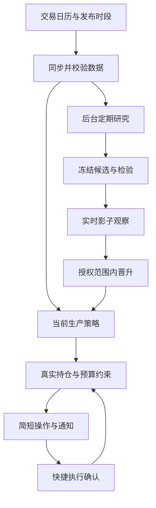

# ClawIndex：自动决策与策略进化升级设计

日期：2026-10-13。状态：完整升级方向与首版实施记录；实际已实现范围见以下说明，完整路线图不等于全部功能已实现。

同日实施更新：VNext 2.0已实现受限均线参数研究、开发/验证/测试检查、固定期限前向观察、授权晋升/回退、今日操作与明确执行确认；本地新版库已备份升级，旧生产源库未改。详细使用与实际限制见[自动进化使用手册](VNext-自动进化使用手册.md)。完整嵌套滚动选策、自动敞口/策略族路由、基金成交模型、组合风险及Linux/GitHub部署仍为后续扩展，本文件后文描述完整方向，不表示全部已实现。

## 1. 用户目标与第一性原理

用户每天时间有限，希望收到简单操作结论，系统承担同步、分析、研究和优化。用户已明确：**优先减少大幅回撤，接受可能少赚**。这替代“用户主要负责研究与复盘”的产品优先级；研究与证据仍保留，移到后台和可展开详情。

未来收益不可确认，系统能控制的是信息截止时点、规则一致性、预算约束、执行频率和实验过程。降低回撤的目标不能解释为保证最大亏损；跳空、延迟、基金净值结算与不执行都可能造成偏差。只优化回撤容易选出永远空仓，应同时衡量收益损失、资金使用和持有对照，明确可接受代价。

系统自动产生操作建议；实际交易仍由用户执行。当前没有账户连接，不能声称已经成交或已改变账户风险。使用指数数据仍有价值，但不足以计算真实基金/账户最大回撤、组合集中度或准确买卖金额。

## 2. 产品入口：用户只需处理待办

首页改为“今日操作”，默认最多展示动作、对象、数量依据、原因、有效时段、执行反馈。无变化时显示“今日无需操作”，正常日可默认不推送；后台失败或信息缺失独立显示具体异常，不能用“无需操作/持有”掩盖。

仅示意文案，不代表现时投资建议：

| 情况 | 简短输出 |
| --- | --- |
| 有效卖出条件，用户确认持有，减仓额度可计算 | “卖出／减仓：某基金；按已设定的敞口规则调整；预计卖出份额××。原因：已触发退出条件。” |
| 有效买入条件，身份与预算均完整 | “买入：某基金；预算上限××元。原因：入场条件成立，风险预算允许。” |
| 有效指数卖出条件但真实持仓未知 | “某指数触发退出条件。若仍持有对应基金，按既定退出计划处理；点一下确认持仓。暂不计算金额。” |
| 无持仓、没有入场条件 | “保持空仓，今日无需操作。” |
| 数据未发布或校验失败 | “暂未生成新操作，正在补数据／需要处理接口故障。” |

所有金额或份额必须标记来自用户报告、实际净值/成交信息或估算，不能将指数点位当作基金净值。历史事件与当前持续条件分开标记；重复巡检不产生重复买入。

通知优先动作变化，其次仍未处理的有效动作，按预设上限温和重提醒；不要求用户每天阅读研究报告。过期动作先重新评估再发送。可一键展开证据、策略版本、失败原因。

## 3. 一次设定与最低维护

一次设定的内容：真实基金映射、持有/空仓状态、可选份额/市值、可用投资现金、每个投资单元预算、接受的回撤与机会成本范围、费用与申赎限制、允许的策略族和参数范围、策略更新频率及自动晋升范围。具体投资额度与阈值尚未确定，不能由程序自行填写成用户授权。

日常只保留三种快捷处理：“已执行”“部分执行”“暂缓”。

- 下单后可标为已提交；基金成交尚未确认时保持待确认，不马上把份额当成已结算。
- 若用户明确确认全额执行且交易信息足够，可以追加交易与持仓快照；记录旧值、数量依据和确认时间，可纠正。
- 部分执行需要最低限度的数量或状态确认，不通过一句“已执行”猜出剩余份额。
- 暂缓可选择原因，按预设时间重新检查有效性；用户无需写长篇反思。
- 定期一键确认“期间未交易”；外部交易或现金变化仍需补录。没有账户接入时无法消除这一步。

目前反馈不更新持仓，新版只能在明确的执行确认流程中同步更新，不能直接改变现有反馈的语义。实际收益账本与模型模拟账本分开，无法核实的金额不纳入真实收益统计。

## 4. 自动运行架构

沿用单机Compose的web/worker与持久SQLite设计；先补齐运行基础，不引入生产自改代码或任意脚本执行。

交易日按各市场已验证的发布时段自动运行，不统一假设所有市场19:00都可用。数据尚未发布时限次重试，行情缺口、来源修订和权限异常分别处理。同指数跨用户共享同步，个人风险约束独立。

任务分优先级：待执行建议与日常巡检优先，研究/补历史使用有界批次，避免研究阻塞卖出提醒。模型接口失败不阻断程序信号；AI解释默认异步或按需。调度、提醒、研究有独立额度与重试上限。

## 5. 自动优化目标：回撤优先但记录代价

研究先满足硬约束，再排序，而不是让AI输出一个自评置信度：

1. 数据可用、基金身份可信、实验无未来泄漏、成本和执行延迟已计入。
2. 风险预算、换手、买卖频率与用户可执行性满足预定限制。
3. 在多个未参与选择的时间窗口中，优先比较回撤及下行损失，报告最差窗口。
4. 检查少赚多少、空仓多久、最久落后持有多久；不得通过几乎不投资虚构“更优秀”。
5. 满足目标的候选之间，偏好规则简单、邻近参数稳定、费用低及跨行业表现不完全依赖单一特殊时期的版本。

至少有三类基准：当前生产版本、相同资金流的买入持有、固定较低敞口加现金。降低风险的改进若只是少持有，应如实标为风险预算调整，不宣称择时能力更强。现金收益、分红及净值费用按数据能力统一建模；缺失时同时展示指数代理结果与限制，不混算真实收益。

初始候选只在小规模、预声明的趋势规则范围内搜索，加入持仓规模/波动约束的研究版本；先不增加大量估值、均值回归、轮动与模型预测参数。基金交易方式限制执行频率；不把短期基金赎回费当统一0.1%。

## 6. 自我进化的具体流程

流程状态为`PROPOSED → HISTORICAL_CHECK → FROZEN → FORWARD_SHADOW → ELIGIBLE → ACTIVE`，另外有`REJECTED / QUARANTINED / RETIRED`。这些是拟新增状态，不是现有RESEARCH/SHADOW界面已拥有的能力。

### 自动提出与历史筛选

默认每周检查数据与运行偏差，每月执行一次有总预算的候选研究；每月研究不等于每月更换。频率是初始工程建议，需经数据量和运行成本验证。AI可从失败记录提出受限参数草案和待验证假设；执行层只接受已注册策略模板，不直接运行模型生成代码。

用按时间推进的训练/选择/检验窗口模拟完整“研究后选择策略”的过程。每个模拟时点只使用当时允许看到的数据，窗口间保留资金和交易状态。评估整个选策略流程及切换成本，不能在看完历史后替每段选择赢家再拼接。

保存所有尝试和失败，包括每个研究周期及跨周期重复尝试，设定搜索预算；同一旧测试集被反馈用于下一轮设计后，标记已消费，不能继续充当全新验证。预先定义比较目标，采用适合时间序列的多重比较/不确定性评估；数据不足时“不足以判断”是合法结果。参考研究[The Probability of Backtest Overfitting](https://www.davidhbailey.com/dhbpapers/backtest-prob.pdf)：在相同历史上反复搜索会增加偶然优胜的风险，简单留出一段数据也不能消除所有问题。

数据版本与可获知时间必须保存；旧行情缺少历史发布时间及修订记录时，标为探索研究。行业回溯历史、幸存者与指数成分变化的限制保留。现有60/20/20报告不能直接复用为无限自动晋升的凭据。

### 冻结候选与实时影子观察

候选参数、评价规则、数据截止时点与比较基准在观察开始前冻结；每天按真实可见行情输出模拟动作，记录产生与预计执行时间，和当前策略对照。影子执行遵守真实基金的估值、假日、申赎延迟、费用及现金规则，能获取的数据不足时只做指数代理观察。

“观察三个月”这类日历长度只是最低观察安排之一，还要看有效决策/交易数量、市场条件覆盖和估计不确定性；几次交易或一段上涨不能证明有效。未达到门槛就继续观察，不靠放宽门槛强行发布。

### 授权范围内自动晋升

用户一次性设置自动管理范围；在这范围内，无需每次重新看报告：允许的策略族、参数/目标敞口变化幅度、最低检验条件、晋升间隔、最大切换频率、风险上限和通知规则。首次启用自动晋升需建立完整政策配置，默认不能从现有ENABLED标记推导出无限自动修改授权。

满足全部条件才更新生产指针；每次保存旧/新版本、证据、理由、适用标的及生效时点。未发现可信候选时保持现版本并报告“本期无合格改进”，不为显示进化而改参数。新增策略族、扩大资金/风险范围或修改用户目标，作为少数需要确认的事项。

晋升按完整模型状态回放，并对照真实持仓计算一次性迁移动作；取消过期旧动作，保持历史不变，防止更新版本当天凭模型初始化制造虚假买入。策略代码更新仍经过GitHub测试/发布；日常自动进化只发布受限配置，不修改源码或自动安装模型生成依赖。

## 7. 市场环境变化与退化处理

市场状态识别有延迟和误判。先研究可连续变化的敞口/风险预算及有限参数适应；未来若引入趋势/震荡路由，必须同时检验识别器、切换迟滞和切换费用的完整策略。不能把事后牛熊标签作为当时已知输入。

线上同时检查技术故障与投资表现：前者包括数据错误、实现偏差、异常成交模拟；后者包括滚动回撤、换手和与基准偏差。表现阈值按预定义窗口和触发机制运行，避免因一次亏损就追逐另一策略。

故障可以自动冻结新的买入建议、隔离候选和停止晋升；若风险退出所需数据仍独立有效，可继续生成退出判断。数据本身无效时，明确告知不能判断，不自动伪造卖出或安全持有。根据预授权政策降级到预先研究的低风险配置，仍是建议且需执行确认。回退旧版本只用于预定义故障或退化政策，旧版本本身也需当前有效，不能保证回退能挽回亏损。

## 8. 风险范围与集中度

电池、机器人、恒生科技的行业暴露不能因为三个名称就认定足够分散。组合相关性、集中度和账户回撤必须基于明确范围、同币种估值和真实敞口；完整账户未知时只报告“已填报投资单元”的风险，不能冒称整个账户。

如果只愿维护有仓/空仓，系统保持明确的指数/对应持仓条件判断，金额未知。要进一步自动分配资金与控制组合风险，需要维护最低账户信息。净值驱动估值能减少重复填写市值，但份额变化与外部交易仍要确认。

预算/现金不仅影响是否买入，也影响模型风险与真实执行偏差。未执行卖出时继续以实际持仓评估风险，不用模型已空仓掩盖。增加自动化无法保证减少实际回撤，尤其无法保证用户不执行时的风险变化。

## 9. 页面与模块调整

| 当前功能 | 升级方式 |
| --- | --- |
| 信号与待执行 | 今日操作卡片、去重提醒、有效期、待成交与快捷确认 |
| 监控与数据 | 自动同步/验证，正常时隐藏操作，异常明确说明 |
| 持仓与预算 | 一次设定、成交后确认更新、期间未交易快捷复核 |
| 策略与研究 | 后台自动研究与影子观察；默认只显示当前版本及进化状态 |
| 历史与反馈 | 系统自动记录证据与执行链，支持简短周/月报，详情按需 |
| AI解释/分析偏好 | 允许自定义重点和语言；不覆盖程序动作，不自动改变风险授权 |

拟新增模块：`decision_policy.py`（用户授权与优化目标）、`execution.py`（确认/成交/持仓账本）、`research_scheduler.py`（有界研究任务）、`validation.py`（时间推进检验与实验记录）、`shadow.py`（冻结后的实时观察）、`promotion.py`（晋升/隔离/状态迁移）。复用现有数据、规则引擎和通知，而不是推倒重写。

拟新增持久实体：policy_versions、experiments/trials、shadow_runs/actions、strategy_promotions、action_requests、execution_confirmations、portfolio_snapshots。所有个人资料和动作按用户隔离；行情共享。显式schema升级、副本迁移和回滚测试后部署。

## 10. 实施顺序与可检验结果

| 阶段 | 交付 | 验收 |
| --- | --- | --- |
| A 少操作 | 完整自动巡检、今日操作、快捷持仓复核、去重/重试 | 不进网页也能收有效变化；数据异常不输出虚假HOLD；无需每天研究 |
| B 执行闭环 | 交易确认、部分执行、待成交、真实/模拟账本分离 | 不重复买卖，不虚构成交；基金异步成交后持仓准确可纠正 |
| C 自动研究 | 实验预算、时间推进检验、风险匹配基准、数据版本 | 全部试验有记录；未来数据不泄漏；永远空仓不能凭低回撤获得晋升 |
| D 影子与晋升 | 候选冻结、实时模拟、边界内自动发布、异常隔离 | 不合格保持原版本；权限与政策越界被阻止；版本切换不重复通知 |
| E 市场适应扩展 | 经研究的敞口适应/有限策略路由、基金/组合层改进 | 检验完整动态流程；分清降敞口效果与择时优势；无法验证时不晋升 |

运行底座与一键更新沿用已设计的[Linux方案](VNext-Linux-运行架构设计-2026-10-12.md)和[发布方案](VNext-一键更新方案-2026-10-12.md)。工程测试通过证明运行语义正确，不证明投资策略能赚钱或满足未来回撤目标。

## 11. 仍需在上线配置中明确的内容

已经确定回撤优先。尚未确定具体资金范围、接受的机会成本、操作频率、自动晋升参数范围与风险额度；这些属于用户投资政策，不是默认策略效果。方案可先开发为关闭自动晋升的研究模式，完成政策配置和检验后逐步启用。当前已开启的渠道/调度保留原状态，不通过本设计操作生产开关。
